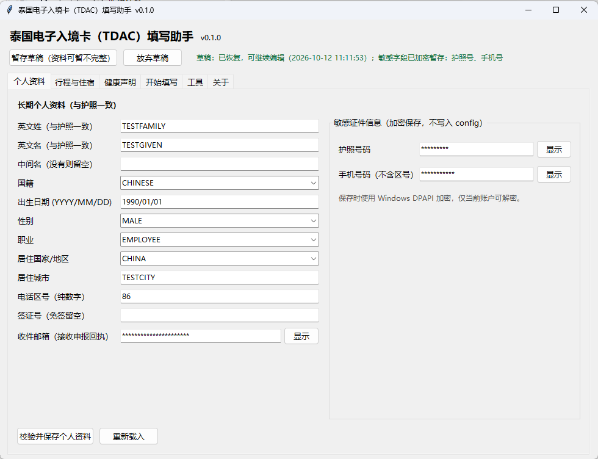
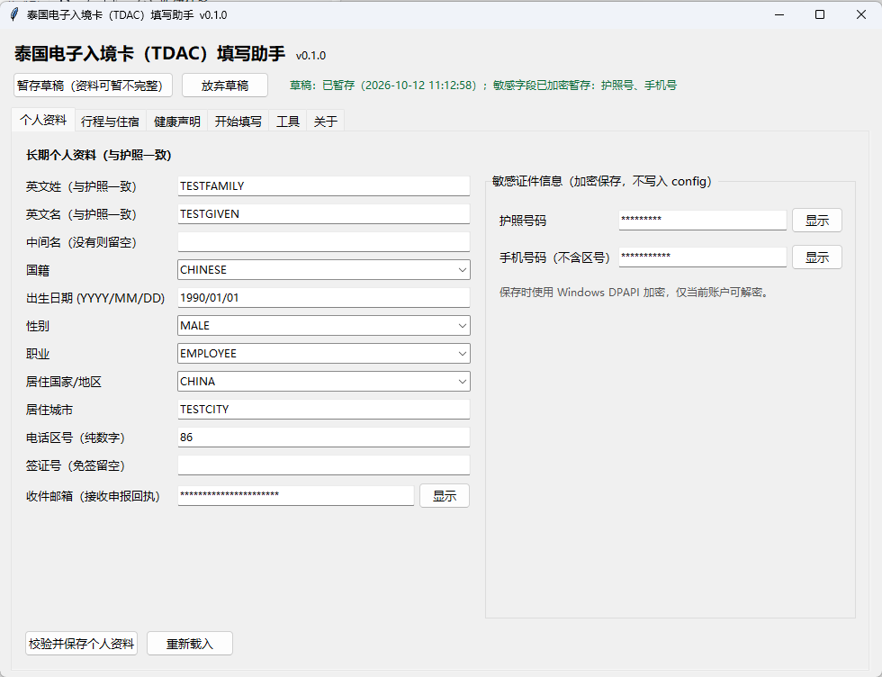
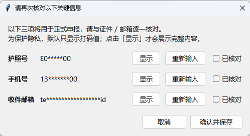

# Thailand Digital Arrival Card (TDAC) Fill Assistant

[简体中文](README.md) | **English**

> An **unofficial, free, open-source** helper for the Thailand Digital Arrival Card (TDAC).
> This tool is **not affiliated** with the Thai government or immigration authorities.
> Official entry point: <https://tdac.immigration.go.th/arrival-card/>

---

## What is this

On **your own computer**, using the Chrome or Edge browser you **already have installed**,
it **pre-fills** the TDAC arrival card form automatically, then stops at the preview page
for you to review every field.

It does **not** submit for you. Reading the terms, ticking the consent box, clicking
**Submit**, and keeping the receipt — **those steps are always yours**.

> ### ⚠️ Pre-filled ≠ submitted
>
> The program stops at the preview page. You must review every value on the official
> website, accept the legal terms, click Submit, and save the official receipt yourself.
> **The program will never do this for you, and cannot confirm whether your declaration
> was accepted.**

---

## Screenshots

| Main window (profile) | Data entry & draft saved |
|---|---|
|  |  |

| Confirmation before formal pre-fill |
|---|
|  |

> All screenshots use **purely synthetic test data** (`TESTFAMILY` / `TESTGIVEN` /
> `E00000000`, etc.). Passport number, phone number and e-mail are **masked with `*`
> by default**, exactly as you will see them.

---

## Who it is for

**It fits you if all of these hold:**

- You run **Windows 11 64-bit** and already have Chrome or Edge installed;
- You hold a **Chinese ordinary passport**, arrive by **air**, travel for **tourism**,
  and stay in a **hotel** (the single-traveler scenario covered by the first release);
- You are willing to review and submit on the official website yourself — you just do
  not want to type dozens of fields by hand;
- You accept that this is a **Beta release**, and will fall back to manual filing if
  something goes wrong.

**It does not fit you if you:**

- Expect a "one-click, auto-submit, receipt-in-inbox" tool — **that is not what it does**;
- Use Windows 10 / macOS / Linux, or travel as a group or by land/sea (not promised in
  the first release);
- Are unwilling to take responsibility for reviewing the data, or expect the software
  to guarantee a successful declaration.

---

## Limitations (Beta — please read fully)

- **This is a Beta release, not a stable one.**
- **The end-to-end flow on the real TDAC website has not been accepted yet.** All
  verification so far was done **offline** (config validation, field mapping, required-field
  checklist, log redaction, offline dry runs, GUI consistency, portable startup). Real date
  windows, real flight-number echo, province/district/sub-district cascades, the preview-page
  e-mail field, and the official receipt after Submit all still need a real test once the
  declaration window opens. **Passing offline does not mean it will succeed on the real
  website in one go.**
- The first release **only supports**: Windows 11 64-bit, **single traveler**, Chinese
  ordinary passport, air arrival, tourism purpose, hotel accommodation.
- Filing is limited by the official **3 days before arrival** window; outside the window the
  program clearly reports and blocks formal pre-fill.
- The program **never auto-submits**, **never accepts the legal terms for you**, **never
  bypasses** captchas / risk control / the official date window, **never guesses** health
  declaration answers (it stops when a value is missing), uploads nothing to third parties,
  and does **not** generate the preview PDF by default.
- Before every formal pre-fill, the program asks you to re-confirm the critical identity
  fields, trip/accommodation and health declaration **for that run**; any change invalidates
  that authorization.
- This project is maintained in spare time; response times for fixes are not guaranteed.

---

## Getting started (portable build, no installation)

### 1. Download

From this repository's **Releases** page, download
`TDAC填写助手-<version>-windows-x64.zip` (for example
`TDAC填写助手-0.1.0-windows-x64.zip`). A checksum file
`TDAC填写助手-<version>-windows-x64.zip.sha256` is published next to it.

### 2. Verify integrity (recommended)

Unsigned programs may trigger a Windows SmartScreen prompt. Download only from this
project's official GitHub Releases and verify the SHA-256 listed on the release page.
PowerShell example:

```powershell
Get-FileHash .\TDAC填写助手-0.1.0-windows-x64.zip -Algorithm SHA256
```

The result must match the value on the release page and inside the matching `.sha256` file.

### 3. Unzip and start

- **Keep the whole `TDAC填写助手` folder after unzipping** — do not copy the EXE out alone.
- Double-click `TDAC填写助手.exe` to open the Simplified Chinese interface.
  **No Python installation is needed**, no administrator rights are required, and
  non-ASCII (Chinese) folder names work fine.

### 4. Enter your data

- Follow the tabs **个人资料 (Profile) / 行程与住宿 (Trip & stay) / 健康声明 (Health) /
  开始填写 (Start) / 工具 (Tools) / 关于 (About)**;
- Passport number, phone number and receiving e-mail are **format-checked and confirmed
  twice** before saving;
- Those three are **masked with `*` by default** — click「显示」(Show) to reveal;
- Not finished? Click **「暂存草稿（资料可暂不完整）」(Save draft — incomplete data is OK)**
  at the top; it is restored automatically next time.

### 5. Start filling

The「开始填写」(Start) tab has two buttons:

- **「离线演练（不触网）」(Offline dry run — no network)**: purely synthetic data, no
  browser, no internet — checks local logic only;
- **「开始正式预填（打开官网）」(Start formal pre-fill — opens the official site)**:
  after validation, opens the real website and pre-fills automatically.

While running you can **pause / resume**, or **stop and take over manually**. At the preview
page the program prints a **redacted** checklist and stops — **you** review, tick the terms,
click Submit and keep the receipt.

### 6. A new trip

Update only the「行程与住宿」(Trip & stay) tab (arrival/departure dates, flight numbers,
accommodation), save, and start again.

---

## Where your data lives, and how to delete it

- User data lives in a **per-user data directory** `%LOCALAPPDATA%\TDAC\`
  (`config\`, `secrets\`, `browser_profile\`, `logs\`, `output\`) — **outside the program
  folder**, so replacing or upgrading the program never overwrites your data.
- Passport number and phone number are encrypted with **Windows DPAPI** (bound to the
  current Windows user + machine). Draft secrets use the **same DPAPI** in a separate file;
  `draft.json` contains no sensitive plaintext. After switching Windows accounts or machines
  the data **cannot be decrypted** and must be re-entered.
- Logs are redacted by default: passport, phone, e-mail, flight number, postal code and
  address are never written in full.
- Sensitive fields in the interface are masked with `*` by default and are only revealed
  when you click「显示」(Show); the program **never** reveals them in the background.
- The preview PDF is generated only when you explicitly ask for it and may contain your
  full personal data — treat it as a sensitive file.

**Deleting data:**

- Graphical interface:「工具」(Tools) tab → **「删除受管用户资料…」(Delete managed user data…)**
  (with an explicit confirmation);
- Command line: `python tdac_fill.py --delete-data` (interactive confirmation; `--yes` skips it).

Both remove config, encrypted secrets, drafts, browser profile, logs and outputs, and verify
first that the target really is inside the managed data directory.

---

## Command line (advanced / troubleshooting)

Portable users normally do not need these; see the developer section below for running
from source.

```
python tdac_fill.py --gui            # Start the Simplified Chinese GUI
python tdac_fill.py --check          # Environment & config check only (no browser)
python tdac_fill.py --dry-run        # Offline check: fully synthetic data, no browser, no network
python tdac_fill.py --smoke          # Same as --dry-run: fully synthetic, no browser, no network
python tdac_fill.py                  # Formal flow (3-day window; opens the official site)
python tdac_fill.py --inspect        # Open the site and dump the current form fields (troubleshooting)
python tdac_fill.py --export-pdf     # Export the preview page as PDF (optional, contains personal data)
python tdac_fill.py --pdf-path PATH  # Where to save the PDF
python tdac_fill.py --session-info   # Read-only session & debug-port info, leftover detection
python tdac_fill.py --export-diagnostic   # Export the redacted diagnostic bundle
python tdac_fill.py --check-update   # Check the configurable update source (only after you ask)
python tdac_fill.py --close-browser  # Close the browser instance started by this program (your normal Chrome is untouched)
python set_secrets.py                # Enter passport / phone number (encrypted, no echo)
python tdac_fill.py --delete-data    # Delete user data managed by this program
```

> `--smoke` and `--dry-run` are always **offline**: they use fully constructed synthetic
> data, never read your real config, never launch a browser and never touch the Thai
> website, so they **cannot** trigger a real submission or a fake declaration. The current
> version provides **no** automated "live-website test mode"; any test that reaches the real
> website requires separate, explicit authorization.

> **Update check** only touches the network when you trigger it in the interface (or run
> `--check-update`); it reads the version number and the official download page only — it
> never auto-downloads, auto-installs or executes remote code. The source is configurable
> (`config/update.json` or the `TDAC_UPDATE_SOURCE` environment variable) and **no address
> is pre-configured**.

> The **redacted diagnostic bundle** contains only whitelisted, non-sensitive metadata
> (version, platform, boolean existence flags). You export it deliberately and may preview
> it before sending; it **excludes** names, passport, phone, e-mail, trip data, browser
> credentials, page screenshots and page source. A self-check refuses the export if a
> sensitive pattern is hit.

---

## Current verification status (important)

- **Only offline verification is complete so far**: local config validation, stopping on
  missing health answers, preview field mapping, required-field checklist and log redaction,
  offline dry runs with purely synthetic data (`--dry-run` / `--smoke`), GUI/config
  consistency, portable offline startup and browser detection have all passed.
- **The real-website flow has not been accepted yet**: real date-window validation, real
  flight-number echo, province/district/sub-district cascade with postal code, preview-page
  e-mail entry and verification, and the official receipt after Submit all still need a real
  test by a human once the declaration window opens.
- **Offline ≠ accepted**: the offline passes only show the source logic is self-consistent;
  they do **not** mean it will succeed on the real website in one go.
- For step-by-step operating instructions (field formats, config changes,
  troubleshooting), see **[使用说明.md](使用说明.md)** (written in Chinese).

---

## Developer section

The rest of this document is for people who want to read the source, build it themselves,
or audit it. Ordinary users do **not** need any of it.

### How it works

- **Browser automation**: starts a visible Chrome/Edge from your own installation with an
  **isolated user-data directory**, driven by **Playwright over CDP**; no browser is bundled.
  Sessions use an isolated directory plus a random **loopback** debug port, with a read-only
  leftover check before start; parameters that widen remote-debugging exposure (such as
  `--remote-allow-origins=*`) are **never** used. If Chrome/Edge is missing you get a Chinese
  explanation with official download links — **no automatic install, no change to your
  default browser**.
- **Secret encryption**: passport and phone numbers use **Windows DPAPI**
  (`CryptProtectData`), bound to the current Windows user + machine; ACLs are tightened to
  the current user after writing.
- **GUI**: Python standard-library **tkinter** only; no additional GUI framework.
- **Portable packaging**: PyInstaller **onedir**, so end users need no Python.
- **Pre-fill gate**: GUI, CLI and the portable EXE share **one** gate with no "skip
  confirmation" switch. It requires: complete data + valid formats + critical fields
  confirmed by you **in this run** + inside the filing window + health declaration
  re-confirmed in this run. The authorization also binds fingerprints of trip, accommodation
  and health answers; changing any of them invalidates it.
- **Network boundary**: no data is sent to any third-party server; only the formal pre-fill
  and the (user-initiated) update check touch the network.

### Running from source

```powershell
python -m venv .build\venv
.build\venv\Scripts\python.exe -m pip install -r requirements.txt
.build\venv\Scripts\python.exe tdac_fill.py --gui
```

Install `requirements-build.txt` as well when you need the build dependencies (PyInstaller).
On first run the config templates from `templates\config\*.example.json` are copied into the
user data directory (existing files are never overwritten). The environment variable
`TDAC_DATA_DIR` overrides the data directory (portable / testing scenarios).

### Building the portable version

```powershell
.build\venv\Scripts\python.exe build_portable.py
```

### Running the tests (all offline)

```powershell
.build\venv\Scripts\python.exe -m unittest discover -s tests -v
```

### Public release process

```powershell
# 1) Produce a clean release staging directory and run the redaction scan
.build\venv\Scripts\python.exe tools\prepare_release.py
# 2) Package the release ZIP from that same build and print its SHA-256
.build\venv\Scripts\python.exe tools\make_release_zip.py
```

`tools/prepare_release.py` uses a **whitelist**: only explicitly listed files/directories
enter the staging directory, and the result is scanned for private absolute paths, real
e-mails / phone numbers / passport numbers, ciphertext, logs, screenshots and similar — any
hit fails the release. `tools/make_release_zip.py` packages the onedir output **within the
same build** and never uploads a pre-built ZIP from a developer machine; after packaging it
reads the ZIP back and compares every file.

### Repository layout

```
tdac-open-source/
├─ tdac_app.py             Single entry point for the portable build (double-click → GUI; with args → CLI)
├─ tdac_gui.py             Simplified Chinese GUI (tkinter)
├─ tdac_fill.py            Main flow: checks, filling, health, preview, export
├─ tdac_group.py           Group data model (multi-traveler not promised in the first release)
├─ tdac_sec.py             Windows DPAPI encrypted secret storage
├─ tdac_paths.py           Program/user data directory separation and safe deletion
├─ tdac_privacy.py         Log redaction + critical-field confirmation
├─ tdac_validate.py        Passport / phone / e-mail validation + formal pre-fill gate
├─ tdac_draft.py           Local draft (single draft; secrets via DPAPI)
├─ tdac_gate.py            Pre-fill authorization gate (critical fields + trip/stay + health fingerprints)
├─ tdac_browser.py         Browser detection, missing-browser guidance, session & debug port
├─ tdac_update.py          Configurable update check
├─ tdac_diag.py            Redacted diagnostic bundle
├─ tdac_synth.py           Fully synthetic test data
├─ set_secrets.py          Enter passport / phone number without echo
├─ build_portable.py       PyInstaller onedir portable build script
├─ tools/prepare_release.py         Clean release staging (whitelist + redaction scan)
├─ tools/make_release_zip.py        Package the release ZIP from the same build + its SHA-256
├─ config/group.example.json        Group config template
├─ templates/config/*.example.json  First-run user config templates
├─ templates/TDAC_同行人必填信息表_template.csv
├─ docs/images/            UI screenshots (purely synthetic data, redacted)
├─ tests/                  Offline unit tests
├─ requirements.txt        Locked runtime dependency versions
└─ .github/workflows/build.yml      Public build workflow
```

### Continuous integration

`.github/workflows/build.yml` runs on GitHub-hosted Windows runners:
install locked dependencies → full offline unit tests → source syntax self-check → offline
dry run → produce the release staging directory and redaction scan → PyInstaller build →
package the release ZIP + checksum from that same output → read the ZIP back and compare
file by file → upload the build evidence. CI injects `github.sha` into the build metadata
(`BUILD_INFO.json` → `vcs.commit`) to prove the ZIP really came from that commit's public
build.

---

## License & security

- This project is released under the **MIT** license — see [LICENSE](LICENSE).
- Third-party dependency license review: [THIRD_PARTY_LICENSES.md](THIRD_PARTY_LICENSES.md).
- Security issues: please report privately — see [SECURITY.md](SECURITY.md).
- `browser_profile\` is the browser's own user directory and may contain cache and cookies.
  **Never** commit it to a repository or share it with others.
